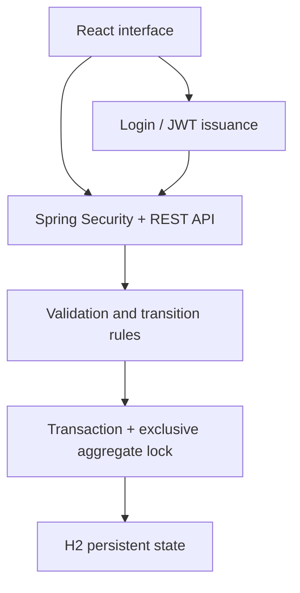

# Architecture

## Public demo
A static Next.js export runs a pure transition engine in the browser. State is saved to localStorage. The role switch is a simulation. There is no central service or shared data on Vercel.

## Local full stack

The Docker build places the static frontend in Spring Boot's static resources. Same-origin calls avoid cross-origin credential handling. Signed tokens carry a role, expire after 30 minutes and are held only in browser memory. Server-side authorization is enforced independently of the UI.

## State and invariants
Incidents follow REPORTED → DISPATCHED → ON_SITE → RESOLVED. A team can have at most one active incident. Resolving releases that team for assignment. Allocations immediately reduce available stock and cannot exceed it; resolved incidents cannot receive new supplies. Rejected transitions do not mutate stored state.

One row stores the operational aggregate as JSON. A pessimistic write lock encloses read, validation and write, so competing requests cannot both reserve one team. This trades scalability for a small, reproducible demonstration. It is not a recommendation for a national dispatch service.

The event list holds the last 100 entries and is not a compliance audit log. There are two configured local accounts, no account registration, password reset, refresh tokens or login rate limiting. H2 is suitable here for reproducibility; the original resume project's MongoDB architecture is not reproduced.

## Verification and limitations
The pure browser rules and Java API have separate tests. Backend tests use real Spring Security and isolated H2 state, including a concurrent assignment check. Docker and cross-browser visual checks require their runtimes and should be run before a production release. No latency, uptime or scale claims are made.
